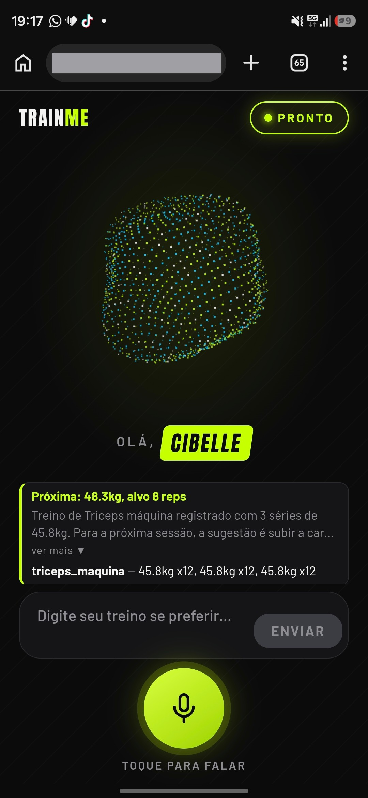
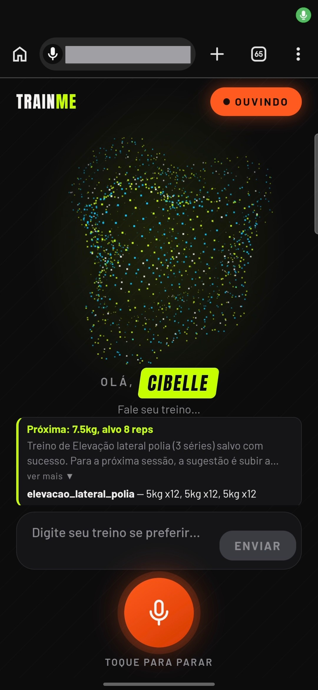
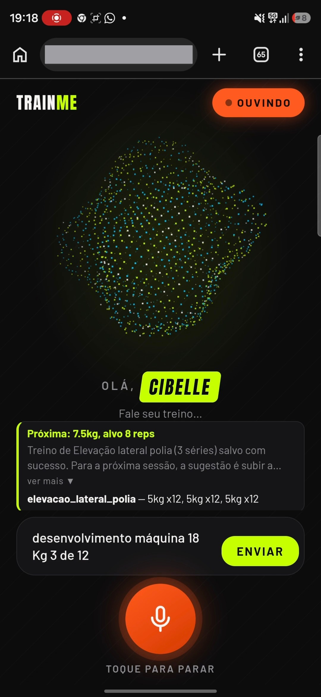

# Treino em linguagem natural

Projeto de portfólio: recebe um relato em português livre sobre treino de
musculação ("supino 4x8 com 80, última até a falha"), extrai os dados
estruturados com um LLM, salva em SQLite e sugere a progressão da próxima
sessão por uma regra determinística (código, não LLM). Inclui um harness de
avaliação que compara configurações de extração.

A sugestão de progressão é uma heurística (dupla progressão simples), **não
é recomendação profissional**.

[Dataset no Hugging Face](https://huggingface.co/datasets/CibelleRodrigues/trainme-treino-ptbr) | [Artigo no dev.to](https://dev.to/cibellesousa/medindo-um-agente-de-treino-o-que-o-few-shot-fez-e-nao-fez-com-um-modelo-local-e-com-o-gemini-54a0)

## Demonstração

| Histórico com sugestão da próxima sessão | Gravando por voz | Voz virando texto no campo |
|---|---|---|
|  |  |  |

## O que faz

1. Você escreve ou fala o treino (ex.: "remada serrote 3x10 com 40").
2. O LLM extrai exercício, séries, carga e repetições (schema fixo).
3. O código normaliza o nome do exercício e a carga (ex.: anilha por lado) e
   grava no banco.
4. O código consulta o histórico daquele exercício e calcula a sugestão de
   carga/repetição pra próxima sessão.
5. O LLM escreve a mensagem final, usando só os números que o código
   calculou — nenhum número mostrado vem direto do texto do modelo.
6. Se o exercício não é reconhecido, ou a carga calculada é implausível
   frente ao histórico (mais de 1,5× a última, ou entre 40% e 60% dela —
   sinal de que pode ser "por lado" em vez do total), o agente pergunta
   antes de gravar.

## Como rodar

```bash
python -m venv .venv && source .venv/bin/activate
pip install -e ".[dev]"
cp .env.example .env   # preencha GEMINI_API_KEY e GEMINI_MODEL
```

- Testes: `pytest -q`
- CLI de extração: `python -m app.extract "supino 3x10 com 80" --provider gemini`
- Gerar a interface (uma vez, ou depois de mudar `frontend/`):
  ```bash
  cd frontend && npm install && npx vite build --config vite.static.config.ts
  cd ..
  ```
  O `docker compose up` já faz esse passo sozinho, dentro da imagem.
- API + interface web: `uvicorn app.main:app --reload` e abra `http://localhost:8000`
- Avaliação:
  ```bash
  python -m eval.validate
  python -m eval.run --config all
  python -m eval.report
  ```
- Exportar histórico: `GET /export.csv`
- Docker: `docker compose up` (sobe a API na porta 8000; precisa do `.env`)

O LLM só faz duas coisas: extrai os dados do texto e redige a mensagem final.
Normalização de exercício, cálculo de carga e regra de progressão são código
puro, com teste — nenhum número que o usuário vê sai direto do modelo.

### Demonstração com histórico de exemplo

`python -m app.seed` carrega `data/progression_sim.csv` (histórico **simulado**,
ver Limitações) no banco, pra já ter algumas sessões anteriores e ver a
sugestão de progressão funcionando sem precisar digitar semanas de treino
antes. Pode rodar de novo sem medo: é idempotente, não duplica sessão já
carregada.

```bash
python -m app.seed
uvicorn app.main:app --reload
```

### Interface web

Tela em React (Vite), buildada como bundle estático e servida pelo FastAPI em
`/`. Tem campo de texto editável e botão de microfone (Web Speech API,
`pt-BR`) — funciona melhor no Chrome (o Firefox não suporta a API de voz). A
página mínima original (sem React) continua disponível em `/simple`. A voz é
só uma camada de entrada de texto; a avaliação é feita sempre em texto.

## Configurações comparadas

| Config | Provider | Modelo | Few-shot |
|---|---|---|---|
| A | Ollama (local) | `qwen3:8b` | não |
| B | Gemini | `gemini-3.1-flash-lite` | não |
| C | Gemini | `gemini-3.1-flash-lite` | sim |
| D | Ollama (local) | `qwen3:8b` | sim |

## Resultados

Dataset completo: 52 exemplos (6 `real`, 46 `sintetico`). Rodada final em
`results/*.jsonl`, relatório completo em `results/report.md`.

Quem quiser reproduzir a avaliação, o dataset anotado está publicado no
[Hugging Face](https://huggingface.co/datasets/CibelleRodrigues/trainme-treino-ptbr)
(dataset card com a estrutura dos campos e as convenções de anotação). Pra
análise completa dos erros — o que o few-shot mudou e não mudou, com o
modelo local e com o Gemini — tem o
[artigo no dev.to](https://dev.to/cibellesousa/medindo-um-agente-de-treino-o-que-o-few-shot-fez-e-nao-fez-com-um-modelo-local-e-com-o-gemini-54a0).

| Config | Exercício | Série | Exato | Latência med. |
|---|---|---|---|---|
| A — qwen3:8b zero-shot | 92% | 39% | 13% | 8,2 s |
| B — Gemini 3.1 Flash Lite zero-shot | 99% | 97% | 94% | 4,4 s |
| C — Gemini 3.1 Flash Lite few-shot | 99% | 98% | 92% | 6,5 s |
| D — qwen3:8b few-shot | 88% | 80% | 67% | 10,0 s |

- Few-shot ajuda muito o modelo local: Qwen vai de 13% (A) pra 67% (D) de
  acerto exato. Sem exemplo no prompt, ele não expande direito `NxM` nem
  o formato de anotação em linhas.
- No Gemini, B e C são basicamente equivalentes (94% vs 92%) — a
  diferença é 1 exemplo num total de 52, dentro do ruído. Few-shot não
  mostrou ganho claro pro Gemini neste dataset.
- Os 46 exemplos `sintetico` foram escritos com ajuda de um LLM a partir
  do histórico estruturado, o que favorece o próprio modelo que os
  avalia (viés de estilo de frase). Nos 6 exemplos `real` o desempenho
  cai: B acerta 4 de 6 (67%) exato, bem abaixo dos 98% nos sintéticos.
- Erro que se repete: `r002`, onde a autora disse "cadeira abdutora" duas
  vezes se referindo a dois aparelhos diferentes (`adutora`/`abdutora`) —
  tag `ambiguo` no dataset, o texto em si não dá pra resolver.
- n=52 é pequeno, principalmente pro recorte `real` (6). Os números acima
  são indicativos, não uma medida definitiva de qual config é "melhor".

## Limitações e próximos passos

- Dataset pequeno: 52 exemplos no momento (meta do SPEC é ~60), e 46 dos
  52 são `sintetico`. Não há `reconstruido` ainda. Com só 6 exemplos
  `real`, as métricas por fonte não sustentam uma afirmação de "o sistema
  funciona bem no mundo real" — só no que foi medido (ver Resultados).
- O texto dos exemplos `sintetico` foi escrito pelo Gemini a partir das
  linhas estruturadas do CSV simulado, revisado pela autora — favorece
  estilos de frase que o próprio Gemini sabe gerar, um viés real na
  avaliação, não só uma limitação de tamanho.
- O histórico de progressão em `data/progression_sim.csv` é **simulado**:
  reconstruído de trás para frente a partir das cargas reais da semana de
  09–11/11/2026, com dupla progressão 8–12. As 3 sessões reais (24/05,
  25/05 e 07/06/2026) são uma amostra pequena à parte. A sugestão de
  progressão é validada por teste unitário, não por dado real suficiente
  pra medir "evolução".
- A regra de ambiguidade de lado no agente olha só o primeiro exercício
  reconhecido da mensagem, pra não gastar as 3 chamadas de ferramenta
  nisso; mensagens com vários exercícios não ambíguos num mesmo pedido
  não passam pela checagem nos demais.
- Voz usa o reconhecimento de fala do próprio navegador (Web Speech API),
  não um modelo próprio: no Chrome Android ela pode repetir ou cortar o
  texto no meio da fala (mitigado, mas é limitação do navegador, não do
  app). O orb pulsa de forma sintética enquanto ouve — não reage ao
  volume real da voz.
- Pela interface não dá pra marcar "treino com personal" nem registrar
  ou exportar repetições na reserva (RIR) — o schema e o CSV já têm os
  campos, só falta o caminho na tela.
- A demonstração roda no notebook da autora, exposta por túnel HTTPS pro
  celular. Sem autenticação: quem tiver o link do túnel acessa o chat e o
  histórico.

### Próximos passos

- Ampliar o dataset com mais exemplos `real` e `reconstruido`.
- Dataset no Hugging Face com dataset card.
- Expor "com personal" e RIR na tela.

## Erros conhecidos (análise qualitativa, dataset atual)

Observados rodando os exemplos reais (`r001`–`r006`) nas configs B, C e D
(ver `results/*.jsonl`):

| Exemplo | O que aconteceu | Causa provável |
|---|---|---|
| `r006` | As 3 configs marcaram `rir=2` só nas 2 séries de 8kg, não nas 3 séries do exercício | "deixei 2 na reserva em ambas" é ambíguo — "ambas" pode significar as duas séries de 8kg (leitura do LLM) ou os dois grupos de série (leitura do rótulo) |
| `r001` (Qwen, config D) | Trocou `elevacao_lateral_polia` por `elevacao_lateral_halteres` e a carga (6kg em vez de 5kg) | sem few-shot suficiente pra essa ambiguidade específica do histórico da autora |
| `r001` (Gemini, config C) | Repetições 12 em vez de 10 | não aplicou a regra "repetição com ajuda do personal não conta" (na rodada final, config B já acertou esse caso — inconsistência entre rodadas, não um erro sistemático de B) |
| `r005` (Qwen, config D) | Perdeu 1 série de `supino_inclinado_maquina` | formato de anotação em linhas (`N x carga x reps`) com séries por bloco — Qwen não expandiu um dos blocos |
| `r002` | Confunde a segunda ocorrência de "cadeira abdutora" | ambíguo no próprio texto: a autora disse "abdutora" duas vezes pra dois aparelhos diferentes (tag `ambiguo`) — não dá pra resolver só com o texto |

Licença: MIT
